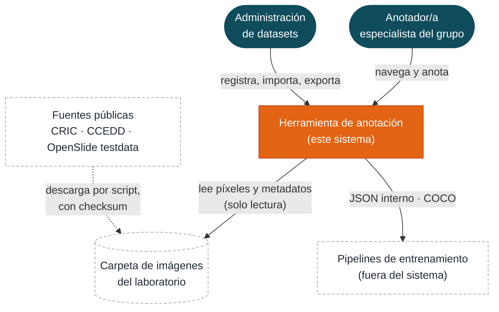

## 3. Contexto y alcance

### 3.1 Contexto del sistema (C4, nivel 1)

*Figura 1. Contexto: quién usa el sistema y con qué sistemas externos intercambia datos.*

| Interfaz externa | Qué cruza | Regla |
|---|---|---|
| Navegador ↔ sistema | HTML y JavaScript de la SPA, JSON, teselas JPEG | Un único origen; sesión por cookie; nada se sirve sin sesión salvo la pantalla de ingreso |
| Carpeta de imágenes | Archivos SVS, JPG y PNG, y los archivos de anotaciones a importar | Montada **solo lectura**; las imágenes llegan por el sistema de archivos del servidor, nunca subidas desde el navegador |
| Exportaciones | JSON interno y COCO | Archivos descargados; referencian las imágenes por su ruta en la carpeta, no las copian (P13, P16) |
| Fuentes públicas | Subconjuntos de CRIC o CCEDD y una WSI de prueba | Se descargan con scripts versionados que verifican checksums; los datos nunca se versionan en el repositorio (ADR-12) |

**Dentro del sistema:** registro de imágenes, catálogo (proyectos, datasets, clases), visualización, edición de anotaciones, autoría, importación, exportación y despliegue. **Fuera:** entrenamiento e inferencia, anonimización de imágenes (`PENDIENTE`, P9), copia de seguridad del almacenamiento del laboratorio y todo lo listado en PPS 1 §6 y PPS 2 §5.

### 3.2 Cómo se ordena el proyecto global

Un solo producto, dos prácticas y una frontera clara entre ellas. La PPS 1 es dueña de todo lo que corre en el navegador y de la lectura de píxeles; la PPS 2 es dueña de los datos y de sus reglas. La frontera entre ambas es HTTP y está escrita en el contrato (Anexo A); dentro del navegador, el visor y el editor se comunican por una interfaz interna del frontend (§5.2).

## 4. Estrategia de solución

### 4.1 Cómo cada objetivo de calidad se convierte en decisiones

| Objetivo | Decisiones que lo sostienen | ADR | Cómo sabemos que se cumple |
|---|---|---|---|
| Corrección de anotaciones | Nivel 0 como única referencia; conversiones solo en el adaptador del visor; la API valida y nunca transforma; autor y fechas los pone el servidor; la base garantiza que la clase pertenezca al dataset de la imagen; concurrencia optimista | 06, 07 | QS-1 a QS-3; casos numéricos del contrato en la CI |
| Instalación reproducible | Un repositorio; un Compose con configuración por `.env`; migraciones y administrador inicial al arrancar; healthchecks; scripts de datos con checksum | 11, 13 | QS-5; prueba de humo del Compose en la CI |
| Extensibilidad | Frontera HTTP entre módulos; adaptadores para visor, lector de slides, importadores y exportadores; JSON interno como fuente de verdad | 02, 08, 09, 10 | QS-9; revisión de dependencias en la CI |
| Confidencialidad | Único origen; teselas protegidas con `auth_request`; nunca se sirven las imágenes asociadas de un SVS; datos fuera del repositorio; funcionamiento sin Internet | 04, 12 | QS-8 |
| Fluidez | DZI al vuelo con caché de slides abiertos; caché HTTP privada; objetivos de latencia medidos con una WSI real | 02 | QS-4 |

### 4.2 Tecnologías y por qué

| Pieza | Tecnología | Motivo principal |
|---|---|---|
| Frontend | React 19 + TypeScript + Vite | Elección de la propuesta PPS 1; el tipado estricto hace verificable el contrato con la API |
| Visor | OpenSeadragon 6 | Impuesto por PPS 1 §4; resuelve pan, zoom y pedido de teselas DZI |
| Capa de anotación | SVG sobre el visor | Pocas decenas a pocos miles de figuras por imagen: SVG da selección y edición nativas sin motor gráfico propio |
| Servicio de teselas | FastAPI + openslide-python | Los bindings de Python son los oficiales de OpenSlide; `DeepZoomGenerator` resuelve la pirámide DZI |
| API | ASP.NET Core 10 + EF Core | Elección de la propuesta PPS 2; migraciones, validación y OpenAPI incluidos |
| Base de datos | PostgreSQL 18 | JSONB para geometrías y procedencia; integridad referencial fuerte |
| Pasarela | Nginx | Sirve la SPA, unifica el origen y autoriza teselas con `auth_request` sin código propio |
| Contrato | OpenAPI 3.1 + JSON Schema 2020-12 | Estándares que generan tipos y validan en los tres lenguajes |
| Despliegue | Docker Compose | Impuesto por PPS 1 §3.8 y PPS 2 §3.9 |

### 4.3 Cinco principios que ordenan el resto

1. **Un dato, un dueño.** Nadie lee la base ajena ni abre archivos que no le corresponden (ADR-03).
2. **Contrato primero, verificado siempre.** Lo que no está en el contrato no existe para el otro módulo; lo que está, lo verifica la CI (ADR-05).
3. **Integrar temprano.** Un esqueleto feo que va de punta a punta vale más que dos módulos lindos que nunca se hablaron (§13).
4. **Configuración, no código, entre entornos.** Pasar de local a servidor es cambiar variables (ADR-11).
5. **Decidir hoy lo caro de cambiar; diferir lo barato.** Coordenadas, autoría, frontera y repositorio se deciden acá. La librería de componentes visuales o el orden de las pantallas los decide cada módulo cuando los necesite.
