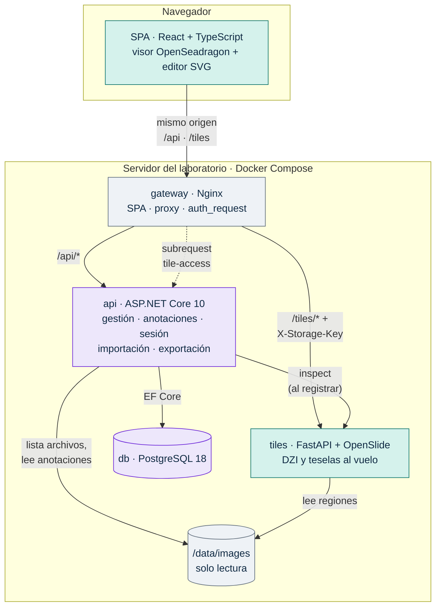
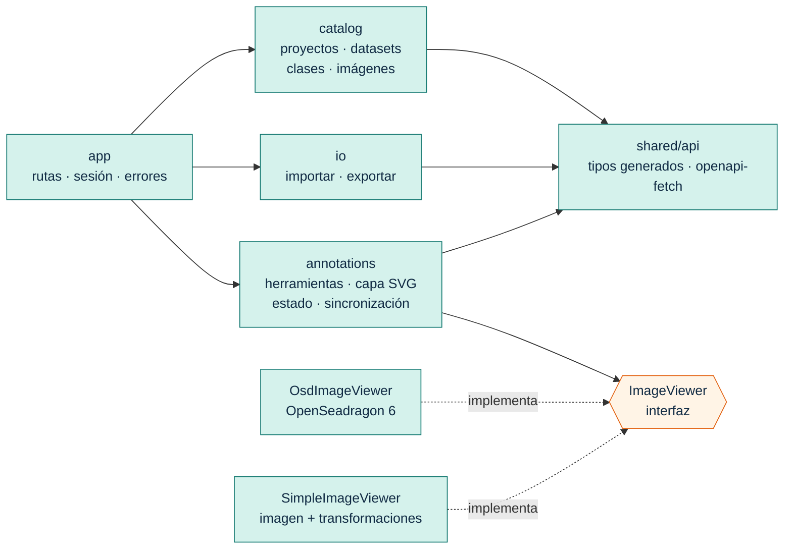
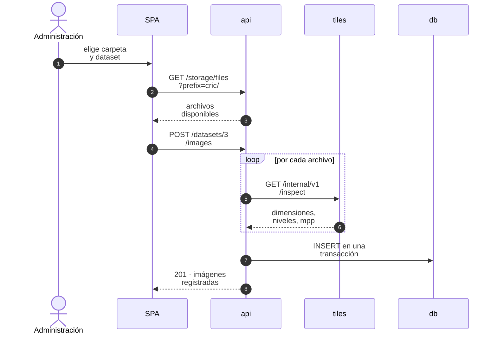
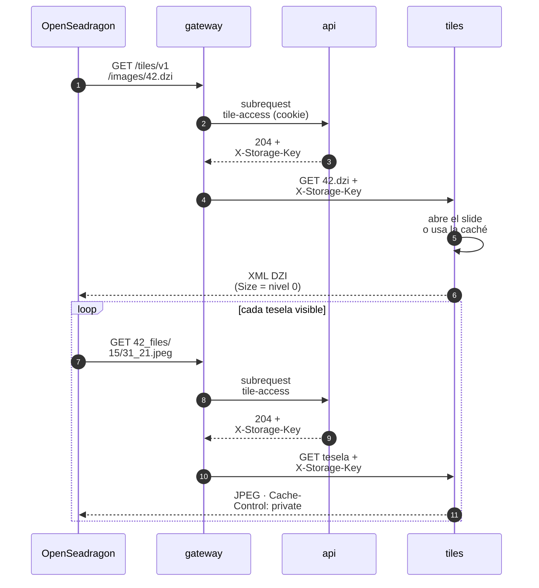
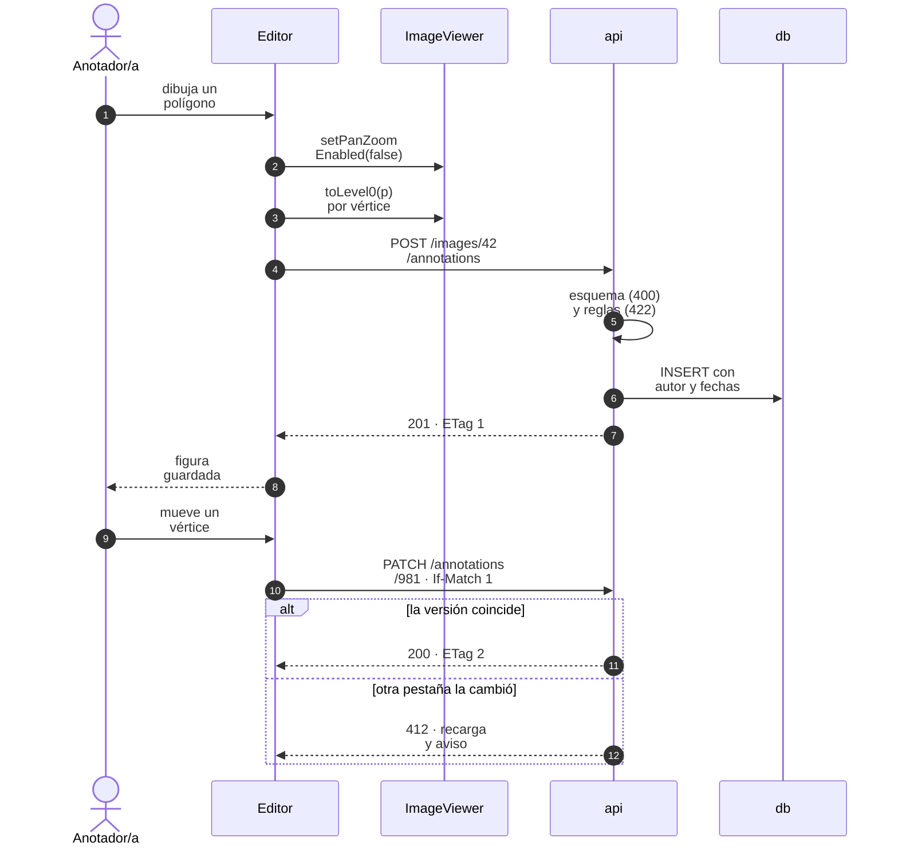

## 5. Vista de bloques

### 5.1 Contenedores (C4, nivel 2)



*Figura 2. Contenedores. Verde: PPS 1. Violeta: PPS 2. Gris: compartido.*

| Contenedor | Responsabilidad | Dueño | Expone |
|---|---|---|---|
| `gateway` (Nginx) | Sirve la SPA compilada; es proxy inverso de la API y del servicio de teselas; autoriza las teselas con `auth_request`; genera `X-Request-ID`; agrega cabeceras de seguridad | Compartido (`deploy/`) | El **único** puerto publicado |
| SPA (`web/`) | Pantallas de ingreso y gestión, visor, editor de anotaciones, importación y exportación | PPS 1 | Archivos estáticos que sirve el `gateway` |
| `api` | Catálogo, registro de imágenes, anotaciones y sus reglas, autenticación, importación, exportación, autorización de teselas | PPS 2 | `/api/v1`, `/internal/v1/tile-access`, `/health` |
| `tiles` | Descriptor DZI, teselas JPEG e inspección técnica de archivos | PPS 1 | `/tiles/v1`, `/internal/v1/inspect`, `/health` |
| `db` | Persistencia | PPS 2 | Solo la red interna |
| Volumen de imágenes | Archivos SVS, JPG, PNG y anotaciones de origen | Administración del laboratorio | Montado solo lectura en `api` y `tiles` |

**Dependencias permitidas y prohibidas.** Las prohibidas no son estilo: cada una evita un acoplamiento que después cuesta caro.

| Desde → hacia | ¿Se permite? | Motivo |
|---|---|---|
| SPA → `gateway` | Sí, es la única | Un origen: la cookie viaja sola y no hay CORS que configurar |
| SPA → `api` o `tiles` directo | No | Rompe el origen único y saltea la autorización de teselas |
| `api` → `tiles` | Solo `GET /internal/v1/inspect` | Obtener metadatos técnicos al registrar sin que la API abra imágenes |
| `tiles` → `api` o `db` | No | El servicio de teselas no conoce usuarios, sesiones ni tablas (ADR-03) |
| `api` → píxeles de una imagen | No | Solo `tiles` abre imágenes con OpenSlide |
| Cualquiera → la base de otro | No | La base es de la API; otros módulos usan su API |
| Navegador → `/internal/*` | No | La pasarela responde 404 a cualquier ruta interna |

### 5.2 Componentes (C4, nivel 3)

**SPA (`web/`, PPS 1).** Organizada por funcionalidad. La regla que más importa: el editor de anotaciones depende del visor **solo** a través de la interfaz `ImageViewer`, nunca de OpenSeadragon.



*Figura 3. Componentes de la SPA. El editor no conoce OpenSeadragon; el visor no conoce anotaciones ni la API.*

La interfaz `ImageViewer` es la parte de frontend del contrato que pide PPS 2 §4 (identificador de imagen, dimensiones de nivel 0, transformaciones, eventos de navegación y capa para superponer). Refina la de la Guía §6.2:

```ts
export interface Point { x: number; y: number }            // x hacia la derecha, y hacia abajo
export type Unsubscribe = () => void;

export interface ImageViewer {
  readonly imageId: number;                                  // id de la API
  readonly level0Size: { width: number; height: number };    // px de nivel 0
  toLevel0(screen: Point): Point;     // px del elemento del visor → nivel 0 (puede caer fuera de la imagen)
  toScreen(level0: Point): Point;     // nivel 0 → px del elemento del visor
  level0PerScreenPx(): number;        // escala actual: tolerancias de clic y grosor de trazo
  onViewChange(cb: () => void): Unsubscribe;   // pan, zoom, animación y cambio de tamaño
  overlayElement(): HTMLElement;      // contenedor alineado con el visor para la capa SVG
  setPanZoomEnabled(enabled: boolean): void;   // se desactiva mientras se dibuja
  onTileError(cb: (failures: number) => void): Unsubscribe;   // para la degradación (§6.6)
}
```

`OsdImageViewer` implementa la interfaz con OpenSeadragon; `SimpleImageViewer`, con una etiqueta `` y transformaciones propias, para probar el editor sin servicio de teselas (PPS 2 §4). Ambos adaptadores pasan **los mismos casos numéricos** del contrato. La regla de dependencias se hace cumplir con ESLint (`no-restricted-imports`) en la CI, no con buena voluntad.

**API (`api/`, PPS 2).** Estructura por funcionalidad; los formatos entran por interfaces.

| Componente | Responsabilidad | Punto de extensión |
|---|---|---|
| Auth y Users | Ingreso, cierre, sesión actual, límite de intentos, administrador inicial, altas por administrador | — |
| Catalog | Proyectos, datasets y clases | — |
| Images | Listado del volumen (`IStorage`) y registro con inspección (`IImageInspector`) | Nuevos formatos de imagen |
| Annotations | CRUD, reglas de geometría (Anexo A), autoría, versión, borrado lógico | Nuevos tipos de geometría |
| Import | `IAnnotationImporter`: `CricImporter` en v0.1 | CCEDD (labelme), predicciones de modelos |
| Export | `IExporter`: interno, COCO y, si hay tiempo, YOLO | Nuevos formatos |
| TileAccess | Endpoint interno que consulta `auth_request` | — |
| Persistence | `DbContext`, migraciones, convenciones de nombres | — |

**Servicio de teselas (`tiles/`, PPS 1).**

| Componente | Responsabilidad |
|---|---|
| Rutas DZI y teselas | Interpretan la dirección `{level}/{col}_{row}`, delegan y fijan `Cache-Control` |
| `SlideRegistry` | Caché LRU de slides abiertos por clave de almacenamiento (tamaño configurable) |
| `SlideReader` (puerto) | Abre un archivo y entrega dimensiones y generador Deep Zoom; el adaptador usa `openslide.open_slide()`, que devuelve `OpenSlide` para SVS e `ImageSlide` para JPG/PNG |
| `StorageKeyResolver` | Acepta solo claves relativas, sin `..`, dentro de `/data/images` |
| `Inspector` | Metadatos técnicos por lista blanca; solo los **nombres** de las imágenes asociadas |

### 5.3 Frontera entre la PPS 1 y la PPS 2

La frontera entre prácticas es HTTP: la API, el servicio de teselas y la cookie de sesión. Dentro del navegador, el visor y el editor se comunican por `ImageViewer`, que es una interfaz interna del frontend (`PROPUESTO`, ADR-08).

| Área | PPS 1 (Gino) | PPS 2 (Nahuel) |
|---|---|---|
| Servicio de teselas | Completo | — |
| Visor | Completo | — |
| Editor de anotaciones | Interacción, dibujo, edición visual y conversión a nivel 0 | Reglas de validez, persistencia, autoría, versión y conjuntos por usuario |
| Pantallas (ingreso, gestión, importar, exportar) | Completas, consumiendo la API | — |
| API y base de datos | — | Completas |
| Importación y exportación | Interfaz de usuario | Lógica, formatos y pruebas |
| Contrato (`contract/`) | Coautor; dueño de `tiles.v1.yaml` y de los casos de coordenadas | Coautor; dueño de `api.v1.yaml` y de los casos de exportación |
| Contenedores | `web`, `tiles` y `gateway`; despliegue en el servidor | `api` y `db`; dueño de la aceptación con el Compose integrado |

### 5.4 Puntos de extensión

Así cumplimos PPS 1 §6 y PPS 2 §5: cada capacidad fuera de alcance tiene un lugar donde enchufarse sin rediseñar.

| Extensión | Dónde se enchufa | Qué no se toca |
|---|---|---|
| DICOM WSI | Adaptador de `SlideReader` y lista blanca de formatos del servicio de teselas; OpenSlide 4 ya lee DICOM | API, SPA y modelo de datos (solo se agrega un valor de `format`) |
| Preanotaciones de un modelo | Un importador de predicciones (`IAnnotationImporter`) con un usuario sintético por modelo y `source = model` | Editor: las predicciones se ven como otro conjunto |
| Active learning | Estado de revisión por imagen y un endpoint de cola; el servicio que elige imágenes vive afuera y lee exportaciones | Geometría y exportadores |
| Consenso y métricas de acuerdo | Conjunto de un adjudicador; métricas calculadas fuera del sistema desde el JSON interno | Modelo de anotación |
| Nuevos formatos | Nuevas implementaciones de `IExporter` o `IAnnotationImporter` | Los exportadores e importadores existentes |
| Historial completo de ediciones | Tabla de revisiones de solo inserción y un endpoint de consulta | API existente |
| Carga por región visible | Columnas de caja envolvente ya persistidas y un parámetro `bbox` en el listado | Esquema de geometría |

## 6. Vista de ejecución

### 6.1 Ingreso

La SPA envía `POST /api/v1/auth/login` con usuario y contraseña. La API verifica el hash y responde `204` con la cookie `gia_session` (HttpOnly). La SPA consulta `GET /api/v1/auth/me` para conocer usuario y rol. Desde ese momento el navegador adjunta la cookie a todo pedido del mismo origen, **incluidas las teselas que pide OpenSeadragon**, sin configuración adicional en el visor.

### 6.2 Registrar imágenes del servidor



*Figura 4. El servicio de teselas mide; la API decide y persiste. Si un archivo falla, no se registra ninguno.*

### 6.3 Abrir una WSI



*Figura 5. Cada tesela se autoriza en la pasarela. El servicio de teselas nunca ve la cookie ni consulta la base.*

Si la sesión venció, la API responde `401` al subrequest y Nginx devuelve `401` al navegador; nunca `302`, porque `auth_request` trata cualquier código fuera de 2xx, 401 y 403 como error del servidor (ADR-04).

### 6.4 Crear y editar una anotación



*Figura 6. La geometría sale del navegador en nivel 0 y el servidor la guarda tal como llegó.*

### 6.5 Importar y exportar

**Importar CRIC.** El administrador elige dataset, formato y carpeta. La SPA llama a `POST /api/v1/datasets/{id}/imports` con `dryRun: true`: la API lee el archivo de anotaciones del volumen, inspecciona las imágenes y devuelve un reporte (imágenes nuevas y ya registradas, clases que se crearían, cajas recortadas) **sin escribir nada**. Con el reporte aprobado, la misma llamada con `dryRun: false` ejecuta todo en una transacción. Cada punto de CRIC se convierte en una caja de lado `boxSize` centrada en el núcleo y recortada a la imagen; el punto original queda en `provenance` y el autor es un usuario sintético `import-cric`, de modo que el ground truth importado es un conjunto más, comparable con los manuales.

**Exportar.** `GET /api/v1/datasets/{id}/export?format=coco&authors=all` devuelve un archivo con `Content-Disposition: attachment`. El exportador COCO se alimenta del mismo modelo que el JSON interno y **no tiene efectos secundarios**, por eso puede ser un `GET` descargable con un enlace común.

### 6.6 Fallas y sesión vencida

| Situación | Qué ve la persona | Qué no puede pasar nunca |
|---|---|---|
| El servicio de teselas no responde | En menos de 5 s, aviso «visualización no disponible»; el catálogo y la lista de anotaciones siguen funcionando | Pantalla en blanco sin explicación |
| La API no responde | Aviso global; el editor pasa a solo lectura y conserva en memoria lo no guardado, con «reintentar» | Mostrar como guardada una figura sin respuesta 2xx |
| Sesión vencida (401 en API o teselas) | Pantalla de ingreso; al volver, regresa a la misma imagen | Bucles de redirección o pérdida silenciosa de cambios |
| Conflicto de versión (412) | Aviso y recarga de la anotación desde el servidor | Pisar la edición de otra pestaña |
