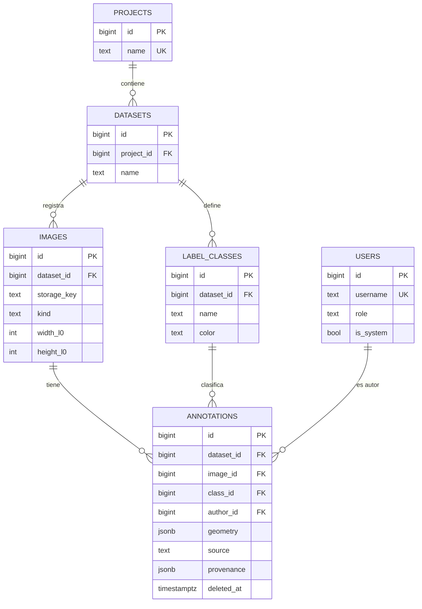

## 7. Vista de despliegue

### 7.1 Un Compose, dos entornos

El mismo `compose.yaml` levanta el sistema en la máquina de cada uno y en el servidor del laboratorio. Lo que cambia entre ambos vive en `.env` y en un archivo de sobreescritura para el servidor; el código y las imágenes de contenedor son idénticos (ADR-11).

```mermaid
flowchart TB
  user(["Navegador"])
  subgraph compose["docker compose · red interna"]
    gw["gateway · :80"]
    api["api · :8080"]
    tiles["tiles · :8000"]
    db[("db · :5432")]
  end
  imgs[("IMAGES_DIR<br/>→ /data/images:ro")]
  pg[("volumen pgdata")]
  keys[("volumen dpkeys<br/>claves de sesión")]
  user -->|"HTTP_PORT → 80"| gw
  gw --> api
  gw --> tiles
  api --> tiles
  api --> db
  api --- keys
  api --- imgs
  tiles --- imgs
  db --- pg
  classDef pps1 fill:#d5f2ec,stroke:#0f766e,color:#102a43
  classDef pps2 fill:#ede7fb,stroke:#6d28d9,color:#102a43
  classDef shared fill:#eef2f6,stroke:#616e7c,color:#102a43
  class tiles pps1
  class api,db pps2
  class gw,imgs,pg,keys shared
```



*Figura 7. Despliegue. Solo el `gateway` publica un puerto; el resto se habla por la red interna de Compose.*

Esqueleto del `compose.yaml` (ilustrativo; el archivo real vive en la raíz del repositorio):

```yaml
services:
  gateway:
    build: { context: ., dockerfile: deploy/gateway/Dockerfile }   # compila la SPA y la copia a Nginx
    ports: ["${HTTP_PORT:-8080}:80"]
    depends_on:
      api:   { condition: service_healthy }
      tiles: { condition: service_healthy }
  api:
    build: ./api
    env_file: .env
    volumes: ["${IMAGES_DIR}:/data/images:ro", "dpkeys:/keys"]
    depends_on:
      db: { condition: service_healthy, restart: true }
  tiles:
    build: ./tiles
    volumes: ["${IMAGES_DIR}:/data/images:ro"]
  db:
    image: postgres:18
    environment: [POSTGRES_DB, POSTGRES_USER, POSTGRES_PASSWORD]
    volumes: ["pgdata:/var/lib/postgresql"]      # VERIFICAR: la imagen de PostgreSQL 18 cambió su ruta de datos
    healthcheck:
      test: ["CMD-SHELL", "pg_isready -U $$POSTGRES_USER -d $$POSTGRES_DB"]
volumes: { pgdata: {}, dpkeys: {} }
```

Al arrancar, la API aplica las migraciones pendientes y crea el administrador inicial si no existe (con las credenciales del `.env`). Hay una sola instancia de la API, así que aplicar migraciones al inicio es seguro. `api` y `tiles` exponen `/health/ready`; la imagen base de ASP.NET no trae `curl`, por lo que el chequeo de salud de `api` usa una herramienta incluida a propósito en la imagen (`VERIFICAR` cuál).

### 7.2 De cero a funcionando

```bash
git clone <url-del-repositorio> gia-anotador && cd gia-anotador
cp .env.example .env               # completar contraseñas; el resto trae valores por defecto
./scripts/fetch-samples.sh         # descarga datos de prueba no sensibles a ./data/images y verifica checksums
docker compose up -d --build       # en el servidor: -f compose.yaml -f compose.server.yaml
./scripts/smoke.sh                 # salud, ingreso, DZI, una tesela, crear anotación, exportar
```

La misma secuencia corre en la CI en cada pull request que toca `deploy/`, `api/`, `tiles/` o `web/` (QS-5).

### 7.3 Qué cambia entre el entorno local y el servidor

| Configuración | Local | Servidor | Quién la define |
|---|---|---|---|
| `HTTP_PORT` | 8080 | 80 (o 443 si hay TLS) | Despliegue |
| `IMAGES_DIR` | `./data/images` (ignorada por Git) | Ruta del disco o NFS del laboratorio (P18) | Administración del laboratorio |
| `COOKIE_SECURE` | `false` (HTTP local) | `true` si hay HTTPS (P19) | Despliegue |
| Contraseñas de base y administrador | Valores locales | Secretos del servidor, fuera del repositorio | Despliegue |
| Reinicio automático, rotación de logs | No | `restart: unless-stopped`, límite de tamaño de logs | `compose.server.yaml` |
| Copias de seguridad | No | `pg_dump` diario del volumen `pgdata` (`scripts/backup-db.sh`) | Despliegue |
| TLS | No | `PENDIENTE` (P19): certificado del laboratorio o proxy existente | Supervisión |

Si el servidor no está disponible antes de la fecha que acordemos, validamos la instalación en una máquina virtual limpia con la misma configuración y registramos el ajuste según PPS 1 §10 (`PROPUESTO`).

## 8. Conceptos transversales

### 8.1 Sistema de coordenadas

Es el concepto que más errores silenciosos puede producir, por eso tiene contrato propio (Anexo A) y casos numéricos que corren en la CI. Lo normativo, en resumen:

- **Toda geometría persistida está en píxeles del nivel 0**, con decimales. Origen en la esquina superior izquierda de la imagen, x hacia la derecha, y hacia abajo. La imagen ocupa el rectángulo continuo [0, W] × [0, H]; el píxel (i, j) cubre [i, i+1) × [j, j+1).
- El servicio de teselas genera el DZI con `limit_bounds=False`: el tamaño del DZI **es** el nivel 0 del archivo, así que las «coordenadas de imagen» de OpenSeadragon coinciden con las de nivel 0 (Guía §5.4).
- **Las conversiones pantalla ↔ nivel 0 ocurren en un solo lugar**: el adaptador que implementa `ImageViewer`. El editor dibuja en nivel 0 y le pide al visor dónde cae cada punto.
- **El servidor valida y nunca transforma.** No normaliza, no redondea, no «corrige». Si una coordenada es inválida, responde 400 o 422 y el error vuelve al editor. Una API que corrige en silencio esconde errores del visor que después aparecen en el dataset exportado.
- Trampas cubiertas por casos del contrato: multiplicar y por el alto en lugar del ancho (el viewport de OpenSeadragon se normaliza por el ancho en ambos ejes); guardar coordenadas de un nivel reducido del SVS; confundir la numeración de niveles de Deep Zoom (0 = 1 × 1 px) con la de OpenSlide (0 = máxima resolución); repetir el primer vértice al final de un polígono.

### 8.2 Modelo de dominio y datos



*Figura 8. Modelo de datos, columnas principales. Las columnas de caja envolvente, área y fechas, y la tabla `imports`, se describen abajo. Nombres en snake_case en la base.*

Reglas que el modelo garantiza, no solo el código (`PROPUESTO` donde responden a Guía §9 P10–P14):

- **La clase pertenece al dataset de la imagen.** `annotations` guarda `dataset_id` y dos claves foráneas compuestas: (`dataset_id`, `class_id`) → `label_classes(dataset_id, id)` y (`dataset_id`, `image_id`) → `images(dataset_id, id)`. La base rechaza lo que un error de código podría dejar pasar.
- **Autor y fechas los pone el servidor**, en UTC. El cuerpo de la petición no puede traerlos: el contrato rechaza propiedades no previstas.
- **Autor y fechas de creación y de última modificación**; sin historial completo en v0.1 (queda como extensión, §5.4). Borrado **lógico** de anotaciones (`deleted_at`); proyectos, datasets y clases con uso no se borran (`RESTRICT`, respuesta 409).
- **Concurrencia optimista** con la columna de sistema `xmin` de PostgreSQL, que el proveedor Npgsql mapea como token de concurrencia; se expone como `ETag` y como `version`.
- `geometry` se guarda tal como llegó; `bbox_*` y `area` los calcula la API al guardar, para exportar y filtrar sin volver a interpretar el JSON.
- `source` y `provenance` registran de dónde viene cada anotación; `imports` guarda el reporte de cada importación.
- Una imagen pertenece a un solo dataset; el mismo archivo puede registrarse en otro dataset como una imagen distinta, con sus propias anotaciones (P10).
- Una clase por anotación y sin atributos extra en v0.1 (P14).
- snake_case en la base mediante una convención de nombres de EF Core (`VERIFICAR` el paquete para EF Core 10).

### 8.3 Formato JSON interno

Es la fuente de verdad de las exportaciones: COCO y YOLO se derivan de él, nunca al revés (Guía §3.5). Su esquema está en `contract/schemas/internal-export.schema.json` y cumple cuatro principios: **se describe a sí mismo** (`format`, `formatVersion` y `coordinateSystem` en el propio archivo), **conserva la trazabilidad** (autor, tipo de autor, fechas, `source` y `provenance` de cada anotación), **no pierde información** respecto de la base y **evoluciona de forma compatible**: las versiones 1.x solo agregan campos opcionales. La compatibilidad con GeoJSON para intercambiar con QuPath queda como extensión (`PENDIENTE`, P17).

### 8.4 Seguridad y privacidad

| Tema | Decisión | Estado |
|---|---|---|
| Sesión | Cookie `gia_session` HttpOnly, SameSite=Lax, `Secure` según entorno, 8 h con renovación por actividad | `DECIDIDO` |
| Claves de la cookie | Las claves de Data Protection de ASP.NET Core se persisten en un volumen: si no, **cada reinicio de la API cierra todas las sesiones** | `DECIDIDO` |
| Contraseñas | `PasswordHasher` de ASP.NET Core Identity: PBKDF2 con los parámetros guardados en el propio hash, lo que permite subir iteraciones sin invalidar contraseñas (100.000 por defecto; fijamos el valor que recomienda OWASP para la función que use .NET 10: `VERIFICAR`) | `PROPUESTO` |
| Fuerza bruta | Límite de intentos de ingreso con el rate limiter de ASP.NET Core: 429 | `DECIDIDO` |
| CSRF | SameSite=Lax + cuerpos solo `application/json` (otro tipo: 415) + verificación de `Origin` en métodos que modifican. Las descargas son `GET` sin efectos | `DECIDIDO` |
| Usuarios | Roles `admin` y `annotator`; sin autorregistro; altas por administrador (endpoint + script); todo usuario autenticado ve todas las imágenes | `PROPUESTO` |
| Anotaciones ajenas | Solo el autor modifica o borra (403 en otro caso); la interfaz muestra por defecto solo las propias (P13) | `PROPUESTO` |
| Imágenes asociadas del SVS | `label` y `macro` pueden contener datos del paciente: **nunca** se sirven; las miniaturas salen de la pirámide | `DECIDIDO` |
| Metadatos | Lista blanca de campos técnicos; nunca se reenvían todas las propiedades del archivo | `DECIDIDO` |
| Cabeceras | `X-Content-Type-Options`, `Referrer-Policy`, `Content-Security-Policy` compatible con OpenSeadragon (`VERIFICAR`) | `DECIDIDO` |
| Sin Internet | Sin CDN, fuentes empaquetadas, sin telemetría | `DECIDIDO` |
| TLS | `PENDIENTE` (P19) | `PENDIENTE` |

### 8.5 Convenciones de la API

- **Rutas:** `/api/v1` para la API, `/tiles/v1` para teselas, `/internal/v1` solo en la red interna, `/health/live` y `/health/ready` en cada servicio.
- **JSON:** camelCase en la API y en el JSON interno (FastAPI usa alias; los formatos externos conservan su nomenclatura, por ejemplo `category_id` en COCO). Identificadores enteros. Fechas UTC en RFC 3339. Valores enumerados en minúscula.
- **Cuerpos estrictos:** una propiedad no prevista es un 400. Detecta a tiempo errores como enviar `class_id` en lugar de `classId`.
- **Listas:** `{ "items": [...] }`; paginación (`page`, `pageSize`, `total`) solo en imágenes, que pueden ser miles.
- **Errores:** RFC 9457 (`application/problem+json`) con `type` como URN `urn:gia:problem:<slug>`, `traceId` siempre y `errors` en los 400. Catálogo en el Anexo A.
- **400 o 422:** 400 si el JSON no cumple el esquema (incluye coordenadas negativas o ancho cero); 422 si viola una regla que necesita contexto o cálculo (límites de la imagen, polígono degenerado o que se cruza, clase de otro dataset).
- **Concurrencia:** `ETag` en cada anotación; `PATCH` exige `If-Match` (428 si falta, 412 si no coincide).

### 8.6 Manejo de errores en la SPA

Un único manejador de respuestas decide: 401 → ingreso, preservando la ruta; 403 → mensaje sin reintento; 409, 412 y 422 → mensaje junto al elemento afectado usando `title` y `detail`; 5xx o error de red → aviso global y reintento con espera creciente. Las teselas fallidas se cuentan con el evento `tile-load-failed` de OpenSeadragon; superado un umbral en una ventana de 5 s, se muestra el aviso de visualización no disponible (§6.6).

### 8.7 Observabilidad

Nginx genera `X-Request-ID` (`$request_id`) y lo propaga a `api` y `tiles`; los tres lo registran y la API lo devuelve como `traceId` en cada error. Así, un error que reporta una anotadora se encuentra en los logs de los tres servicios con un solo identificador. Logs en JSON a la salida estándar (`docker compose logs`), nivel configurable por variable. Nunca se registran contraseñas, cookies ni contenidos de imágenes.

### 8.8 Configuración

Solo variables de entorno, documentadas en `.env.example` con su valor por defecto y su propósito. Ningún secreto en el repositorio. Ninguna URL absoluta en el código: la SPA usa rutas relativas al origen, por eso el mismo artefacto sirve en `localhost:8080` y en el servidor.

### 8.9 Estrategia de pruebas

| Nivel | PPS 1 (`web/`, `tiles/`) | PPS 2 (`api/`) | Compartido |
|---|---|---|---|
| Unitarias | Vitest: conversiones de ambos adaptadores de visor, utilidades de geometría, reducer del editor. pytest: direccionamiento DZI, validación de claves, lista blanca de metadatos | xUnit: reglas de geometría, exportadores, importador CRIC, reglas de autoría | — |
| Contrato | Casos de `contract/fixtures` ejecutados desde Vitest y pytest; tipos generados compilan con `tsc --strict` | Mismos casos desde xUnit; la OpenAPI generada en el build se compara con la del contrato | `scripts/check_contract.py` en la CI |
| Integración | `tiles` con OpenSlide real sobre una PNG sintética y una WSI de prueba pequeña | API contra PostgreSQL real (Testcontainers) con `IImageInspector` falso | — |
| De punta a punta | — | — | `scripts/smoke.sh` contra el Compose completo en la CI |
| Interfaz | Guion manual reproducible con capturas esperadas (la automatización de UI queda fuera de la PPS 1) | — | Guion de aceptación de cada PPS |

No fijamos un porcentaje de cobertura (`PENDIENTE`, P23). Fijamos algo más útil: **ningún criterio de aceptación de una historia se da por cumplido sin una prueba automatizada o un paso del guion que lo demuestre** (DoD, §12.5).
